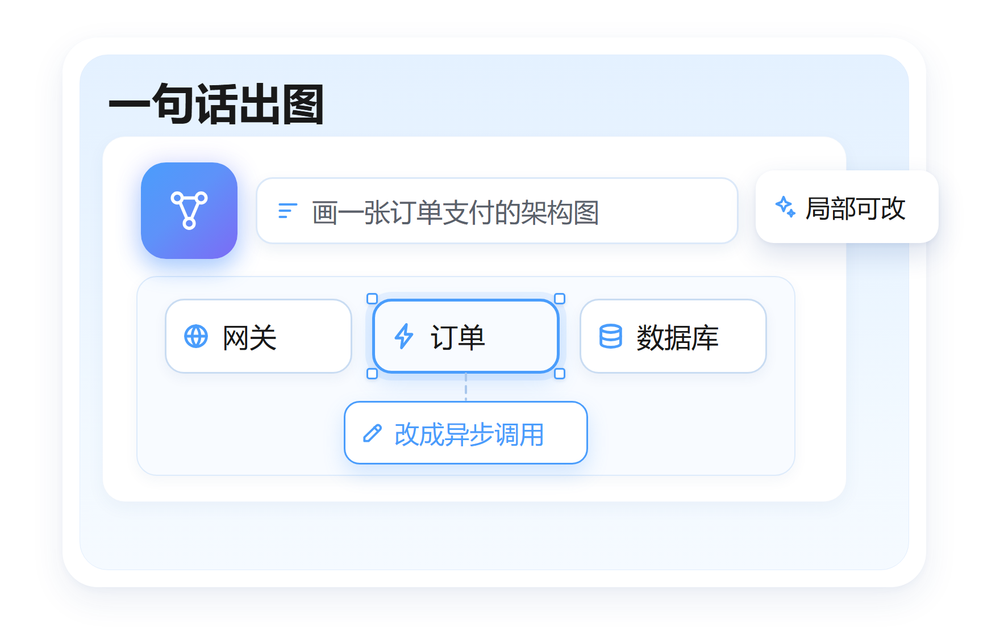
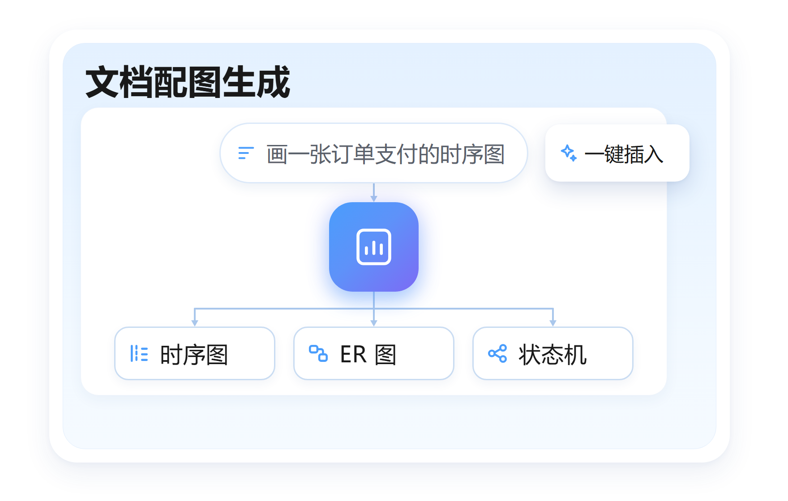
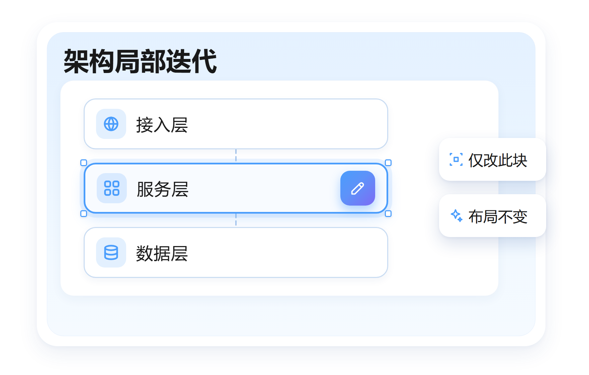

# 产品场景图生成 Skill

**Product Scenario Illustration** — 一个可直接安装的 Agent Skill。装好之后，给 Agent 一个标题，它就能产出一张 1760×1120 的扁平矢量场景图；同一个标题反复生成，结果完全一致。




---

## 效果

<table>
<tr>
<td width="33%"><br><sub><b>B · 上→下分叉</b><br>一句话生成时序图 / ER 图 / 状态机 / 拓扑图</sub></td>
<td width="33%"><br><sub><b>C-2 · 分层选中态</b><br>只改一块，其余布局与样式不动</sub></td>
<td width="33%"><br><sub><b>C-1 · 画布编辑态</b><br>自然语言生成 + 局部修改</sub></td>
</tr>
</table>

这三张不是手绘的，也不是 AI 生图，是 [`examples/src/`](examples/src) 里那三个 HTML 被浏览器渲染出来的。改一行文字、重新渲染，就得到新的一张。

## 它解决什么问题

一个产品有二十个功能点，要做二十张风格一致的配图塞进 PPT、官网、产品文档。找设计师太慢；用 AI 生图，每次风格都不一样，中文标签还会糊成伪文字。

这个 skill 的做法是：**把风格固化成代码**。壳层几何、色值、字号全部写死，模板只有一套壳，Agent 只负责选版式、填内容、渲染。所以出来的图永远属于同一个家族，而且可以批量。

| 项 | 值 |
|---|---|
| 输出尺寸 | 1760 × 1120（11:7） |
| 设计验收尺寸 | **240px 宽**（图最终常被放进网页卡片，按这个尺寸设计） |
| 技术栈 | HTML + CSS + 内联 SVG |
| 渲染器 | Edge / Chrome / Chromium headless |
| 依赖 | **无**，`scripts/` 只用 Python 标准库 |
| 单张耗时 | 约 2 秒 |

## 安装

Skill 的标准形态是「一个目录 + 根部的 `SKILL.md`」。克隆下来，把目录名改成 skill 名即可：

```bash
# WorkBuddy / 用户级技能目录
git clone https://github.com/sunhaha369369/hwcloud-scene-image-skill.git \
  ~/.workbuddy/skills/hwcloud-scene-image

# 或者装到某个项目里（团队共享）
git clone https://github.com/sunhaha369369/hwcloud-scene-image-skill.git \
  <your-project>/.workbuddy/skills/hwcloud-scene-image
```

Windows：

```powershell
git clone https://github.com/sunhaha369369/hwcloud-scene-image-skill.git `
  "$env:USERPROFILE\.workbuddy\skills\hwcloud-scene-image"
```

装完不需要再做任何配置。Agent 会在识别到「场景图 / 配图 / 功能示意图」这类请求时读取 `SKILL.md`；也可以直接说「用 hwcloud-scene-image 画一张…」显式点名。

**前置条件**：装有 Edge、Chrome 或 Chromium 任一。找不到时可用环境变量指定：

```bash
export SCENE_BROWSER="/Applications/Google Chrome.app/Contents/MacOS/Google Chrome"   # macOS / Linux
set SCENE_BROWSER=C:\Program Files\Google\Chrome\Application\chrome.exe              # Windows
```

## 怎么用

### 一句话触发

> 帮我画：软件架构设计与迭代-每次只改动目标区域，无需整图重绘，保持已有布局和样式不变，适合架构频繁演进的开发节奏。

Agent 拿到标题后会走完这套流程（`SKILL.md` 里的 5 步）：

1. **长标题 → 短标题 + 浮标**：压到 4–6 个汉字，浮标写 4 个字的「承诺」（「仅改此块」「布局不变」）。
2. **选版式**：按标题特征落到 B / C-1 / C-2 / A 四种骨架之一，每种都有现成模板。
3. **改模板**：只改标题、标签、浮标、例句，壳层 CSS 一行不动。
4. **渲染**：`render.py` 出图，自动校验尺寸和每根连线的端点。
5. **缩略自检**：`preview.py` 缩到 240px，按 `references/checklist.md` 逐条核对。

### 不经 Agent，自己改模板

模板本身就是可运行的完整 HTML，想手工调整也可以：

```bash
cp assets/template-c-arch.html my-figure.html
# 改标题 / 标签 / 浮标 → 保存
python scripts/render.py my-figure.html my-figure.png
python scripts/preview.py my-figure.png --width 240
```

## 三个脚本

| 脚本 | 作用 | 退出码 |
|---|---|---|
| `scripts/render.py` | HTML → 1760×1120 PNG，自动探测浏览器、校验尺寸、调用连线检查 | `0` 成功 / `1` 无浏览器 / `2` 渲染失败或尺寸不符 / `3` **连线有悬空端点** |
| `scripts/linklint.py` | 单独检查每根连线的两端是否贴住元素边缘或接上另一根线 | `0` 通过 / `1` 有悬空 |
| `scripts/preview.py` | 按目标宽度生成缩略图，用于「240px 还能不能读」的验收 | `0` 成功 |

三个脚本都只依赖 Python 标准库，跨 Windows / macOS / Linux 可用。

### 为什么渲染要过脚本

headless 浏览器在**非 ASCII 路径**（含中文或空格的目录）下经常静默失败：输出空白图，或者沿用上一次的旧图。`render.py` 会先把 HTML 复制到纯 ASCII 临时目录再渲染，所以路径里带中文也能正常出图。

### 为什么连线要机器检查

连线是全图唯一需要手写绝对坐标的部分，也是最容易出事的地方。一段线少写几百像素，整张图看着依然「像那么回事」——1760 原图上不放大看不出来，缩到 240px 更是完全看不见，直到图交出去才被人指出。

`linklint.py` 不靠眼睛：它让浏览器算出每条线的真实端点（`getPointAtLength` + `getScreenCTM`），逐个判断是否贴着某个元素边缘（≤8px）或与另一条线相交（≤3px）。不满足就打印出「第几条线的哪一端、在什么坐标、还差多远」：

```
[x] 发现 1 个悬空端点：
    第6条线 起点 在 (1235,690)，最近的物体还差 40px  d="M1235 690 V716"
```

这个检查抓到过一个真实事故：三叉分叉的右支线整整少了一段 800px 的横线，肉眼完全正常。`SKILL.md` 里因此写死了「分叉必须拆成枢纽 + 独立段」的画法。

## 仓库结构

```
.
├── SKILL.md                      # 给 Agent 读的主文档：铁律、几何、工作流、连线规范
├── references/
│   ├── style-tokens.md           # 色值、字号、圆角、投影的完整 token 表
│   ├── layouts.md                # 四种版式的骨架图、适用场景、元素配方
│   └── checklist.md              # 交付前逐条核对（含 240px 缩略验收）
├── assets/
│   ├── _blank-shell.html         # 只有壳层，从零搭版式时用
│   ├── template-b-flow.html      # B  上→下分叉
│   ├── template-c-ui.html        # C-1 画布编辑态
│   └── template-c-arch.html      # C-2 分层选中态
├── scripts/
│   ├── render.py                 # HTML → PNG（路径处理 + 浏览器探测 + 连线检查）
│   ├── linklint.py               # 连线端点几何校验（render.py 会自动调用）
│   └── preview.py                # 生成缩略图，做「缩略自检」
└── examples/
    ├── 01-document-diagram-generation.png
    ├── 02-architecture-evolution.png
    ├── 03-diagram-canvas.png
    └── src/*.html                # 三张示例图的可渲染源文件
```

`examples/` 只作展示，不参与生成；Agent 运行时只需要 `SKILL.md` + `references/` + `assets/` + `scripts/`。

## 风格约束（skill 想保证的东西）

一句话定性：**扁平矢量 UI 示意图**。用卡片层叠造深度、用渐变图标瓦片承载主体、用虚线表达流程。**无人物、无透视、无照片质感。**

| 维度 | 约束 |
|---|---|
| 构图 | 三层嵌套卡片逐层向右下偏移（唯一的深度来源）+ 1–2 个破框浮标 |
| 配色 | 色相锁死 200°–250°，主蓝 `#4A9DFC` → 紫端 `#7C6BF5`；唯一暖色 `#F58A8A` 只表告警 |
| 光影 | 无方向光、无高光；只有三级层高投影，色是深蓝 `rgba(31,71,141,…)` 而非黑 |
| 视角 | 严格正交正视 0° 透视，所有矩形轴对齐 |
| 密度 | 内容区元素 **≤ 7 个**，一图一件事 |
| 可读性 | 字号 ≥ 40px、描边 3–5px，按 240px 观看校核 |

这些数字都在 `references/style-tokens.md` 里，改一处就能整体换肤（比如换主色、换圆角），不需要碰模板。

## 它不适合做什么

- **需要文字氛围感的封面插画** —— 用 AI 生图更好，那类图不需要精确文字。
- **信息量大的架构全景图** —— 这张画布是为「一图一件事」设计的，塞二十个节点会糊。真要画复杂拓扑，用专业绘图工具。
- **照片级、3D、拟物风格** —— 这套 token 表锁死了扁平平涂，硬改会四不像。

## 相关

这个包是从 [sunhaha369369/hwcloud-scene-image](https://github.com/sunhaha369369/hwcloud-scene-image) 抽出来的运行态：主仓库里还有风格分析报告、可视化风格指南（10 节）、以及从 20 张参考图反推设计决策的过程记录。想改造视觉体系，从那边读起；只想直接出图，用这个仓库就够。

## License

MIT。见 [LICENSE](LICENSE)。
